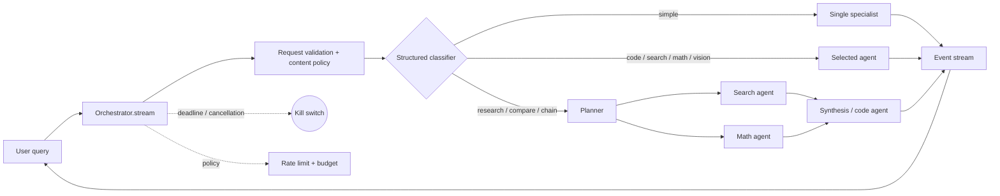
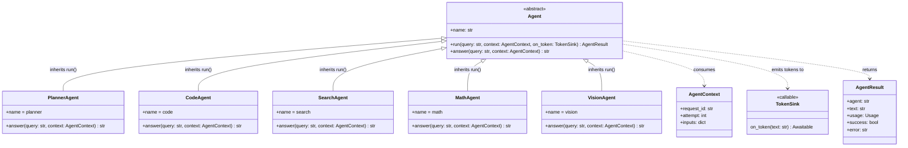
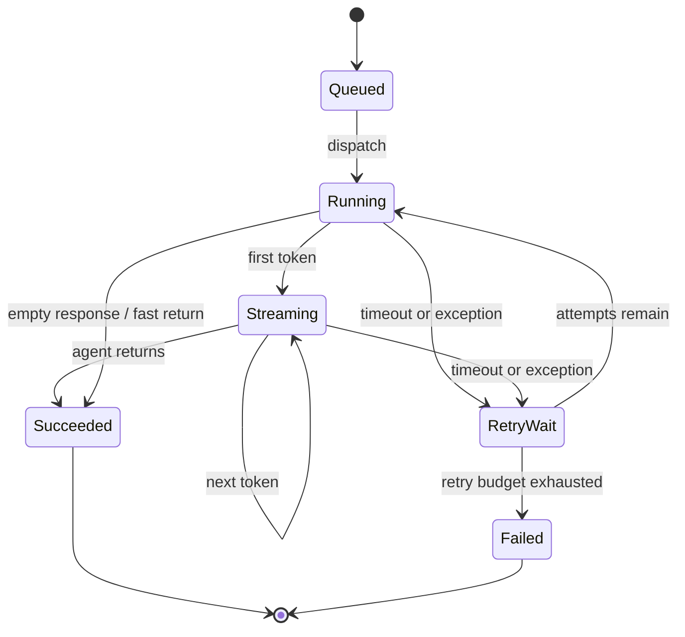
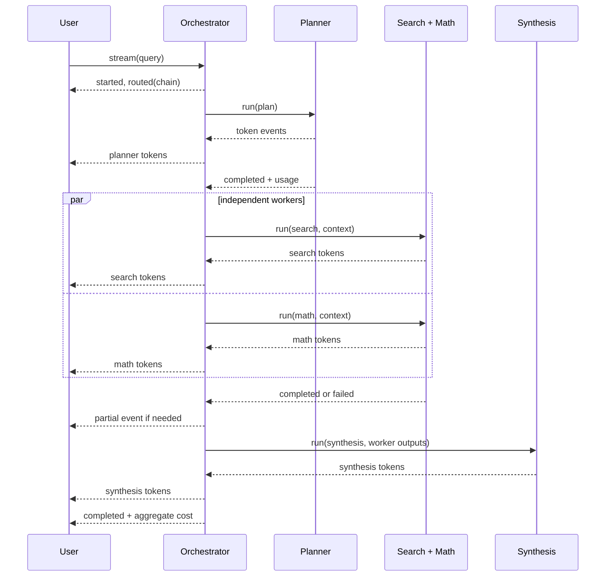
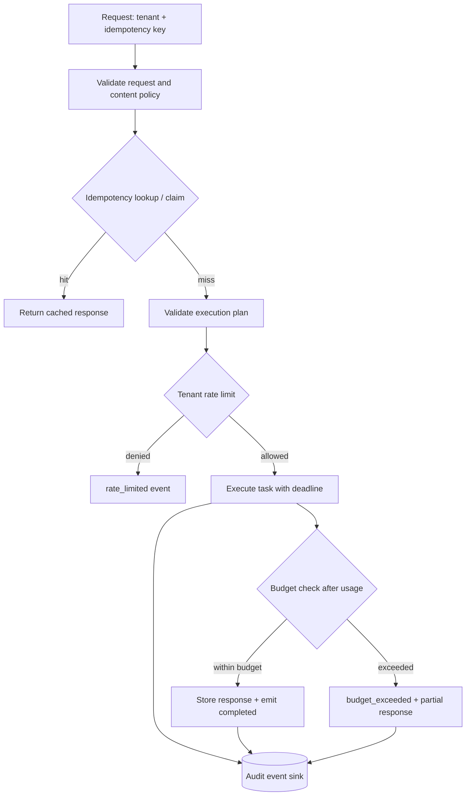
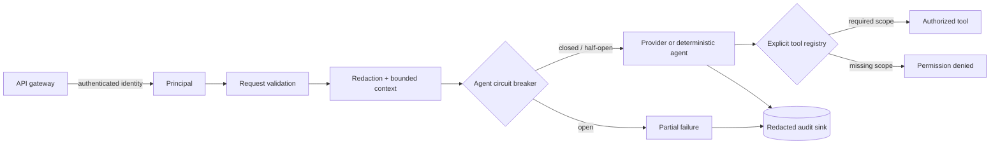

# Multi-agent Orchestrator


A small, runnable reference implementation of a production-shaped multi-agent orchestrator. Given one user query it can:

- answer through one specialist or route a simple query directly;
- build and execute a planner/worker DAG across planner, search, math, code, and vision agents;
- stream tokens and lifecycle events while work is still running;
- retry individual agents without replaying the entire request;
- return partial results when a worker fails;
- track input/output tokens and estimated cost; and
- cancel the whole request when its deadline (30 seconds by default) is reached;
- validate execution plans before scheduling them;
- enforce tenant-scoped rate limits and spend budgets;
- append every event to an injectable audit sink; and
- replay completed requests safely through an idempotency key.

The agents are deterministic demo adapters, so the project runs offline. The same agent contract also accommodates provider-backed implementations through `ProviderAgent`.

This project is intentionally provider-neutral: there are no credentials, network calls, vendor SDKs, or hidden model dependencies. That makes the orchestration behavior testable and reviewable on a laptop.

## Quick start

```bash
python -m venv .venv
source .venv/bin/activate
pip install -e '.[dev]'
python -m pytest -q
orchestrator-demo
```

With the repository's `uv` workflow:

```bash
uv venv
uv sync --extra dev
uv run pytest -q
uv run orchestrator-demo
```

Or use the library directly:

```python
import asyncio
from orchestrator import Orchestrator, Request

async def main():
    orchestrator = Orchestrator()
    async for event in orchestrator.stream(
        Request("Research and compare an API design, then calculate the tradeoffs")
    ):
        if event.type.value == "token":
            print(event.data["text"], end="")

asyncio.run(main())
```

## Architecture

### 1. Runtime topology

The router is a small policy boundary. `StructuredClassifier` returns a typed, cycle-validated `ExecutionPlan`; `RuleBasedClassifier` remains as a backwards-compatible name for the deterministic implementation. The scheduler stays independent of how plans are produced.



### 2. Agent class hierarchy

All workers expose the same asynchronous contract. `Agent.run()` owns token emission and usage calculation; subclasses only provide domain behavior.



The five concrete agents intentionally do not duplicate `run()`. They inherit the shared lifecycle, streaming, and usage accounting implementation from `Agent`; each one only specializes `answer(query, context)`. `AgentContext` is therefore a parameter of both the inherited execution method and every specialist implementation.

### 3. Single-agent execution state machine

Retries stay inside one task. A timeout or exception is converted into a failure event, so the orchestrator can continue with a partial result or move to the next DAG node.



### 4. Streaming sequence for a chained request

The user sees tokens from early nodes before the DAG is complete. The queue also preserves explicit failure and partial-result signals for a UI.



### 5. Request control plane

Policy is applied at the orchestration boundary, before work becomes an external side effect. Event sinks and idempotency stores are ports, allowing the same orchestration semantics to span an in-memory demo, local persistence, or transactional infrastructure.



### 6. Security and reliability boundaries



## Design decisions

### Routing and DAG execution

`router.py` returns a route and a human-readable reason. Chain mode creates four tasks with dependencies: planning first, search and math in parallel, then synthesis. The scheduler repeatedly finds ready tasks and uses `asyncio.gather()` for parallel branches.

### Streaming and back-pressure

`Orchestrator.stream()` starts a producer task and exposes an async iterator backed by an `asyncio.Queue`. The consumer controls the pace of reads, so a slow UI naturally applies back-pressure. Closing the iterator cancels the producer and does not leave background agent work behind.

### Failure isolation

Each task has its own retry loop and ten-second per-attempt guard. Exhausted retries produce `agent_failed` and `partial` events. A failed dependency is represented as `[unavailable]`, allowing downstream synthesis to proceed with an honest degraded context.

### Kill switch and cost tracking

The outer `asyncio.wait_for()` enforces the request deadline and cancels all nested work. Every successful agent result includes input tokens, output tokens, and an estimated USD cost; `run()` aggregates those values into the final `Response`.

### Validated plans

`StructuredClassifier` returns an immutable `ExecutionPlan` containing typed `PlanTask` values. Before execution, the plan is checked for duplicate names, unknown agents, unknown dependencies, and dependency cycles. `RuleBasedClassifier` is retained as a compatibility subclass; a model-based classifier can implement the same contract and inherit the same safety checks.

### Multi-tenant controls

`TenantRateLimiter` and `TenantBudgetLedger` are fast in-process defaults. `SQLiteTenantPolicyStore` adds transactional, WAL-backed shared state for local multi-process deployments, while Redis/Postgres are natural implementations of the same policy contract when replicas span hosts. Both paths are keyed by `Request.tenant_id`.

### Auditability and idempotency

`JsonlEventSink` is an inspectable append-only adapter. `SQLiteEventSink` adds transactional event persistence and request replay queries. `SQLiteIdempotencyStore` provides a durable table with TTL, ownership claims, fingerprints, conflicts, and cleanup; JSON-file and in-memory stores cover lightweight demos and tests. Kafka, Postgres, or a managed collector fit the same ports at larger scale.

### Observability contract

Every event includes `request_id`; task events include agent and task names; completion events include usage. This gives a UI or telemetry adapter enough information to measure route mix, time-to-first-token, agent latency, retry rate, partial-response rate, cost per tenant, and kill-switch activations without coupling the core to a logging vendor.

### Security and reliability controls

The security layer validates query size, timeout, retry count, budget, metadata cardinality, and idempotency-key size. A `Principal` represents identity supplied by an upstream authenticator and can be required to match the request tenant. Event payloads are redacted before they reach an audit sink, queues are bounded to apply back-pressure, and a circuit breaker prevents repeated calls to an unhealthy agent. `ToolRegistry` requires an explicit scope for every tool; agents cannot invoke arbitrary functions.

These controls provide defense in depth; prompts are still treated as untrusted data. A complete product combines them with identity, secret-management, network, and content-safety infrastructure appropriate to its risk profile.

### Provider and tool ports

`ProviderAgent` is the provider boundary. It receives a provider object, keeps credentials out of `Request`, streams provider output, and uses provider-reported token counts for cost accounting. `DeterministicProvider` supplies the same contract without network access. `ToolRegistry` is a separate authorization boundary for tool-calling integrations; every registered tool declares a required scope and whether it has side effects.

Retries are policy-driven through `RetryPolicy`. The default retries transient-looking exceptions but stops immediately for authorization, input, and type errors. Provider integrations can inject a stricter policy for their own error taxonomy.

## Project layout

```text
src/orchestrator/
  agents.py        agent contract and five specialists
  models.py        requests, events, usage, and responses
  router.py        structured plan, validation, and classifier
  policy.py        rate/budget stores, breakers, and retry policies
  storage.py       JSONL/SQLite event and idempotency stores
  auth.py          local identity and authorization adapters
  content.py       baseline content/DLP policy
  security.py      principals, validation, and safety limits
  observability.py redaction and vendor-neutral metrics
  secrets.py       encrypted secret store
  provider.py      provider adapter contract and offline provider
  tools.py         scoped tool registry
  orchestrator.py  streaming producer, policy, and DAG scheduler
  demo.py          offline CLI showcase
tests/
  test_orchestrator.py  routing, policy, persistence, and failure tests
```

## Architecture decisions and tradeoffs

| Decision | Benefit | Cost / boundary |
|---|---|---|
| Async iterator plus queue | Natural streaming and consumer back-pressure | Requires an async application boundary |
| Immutable validated plan | Prevents malformed or cyclic schedules | A classifier must map into the plan schema |
| Parallel ready tasks | Lower chain latency and better throughput | More concurrent token spend and more complex ordering |
| Per-task retries | One flaky provider call does not replay the DAG | Non-idempotent tools need their own side-effect guard |
| Partial results | Useful degraded answers instead of all-or-nothing failure | Consumers must surface confidence and missing work clearly |
| In-process defaults plus SQLite shared adapters | Zero infrastructure for demos; transactional local multi-process mode | Replace SQLite with replicated storage across hosts |
| JSONL plus SQLite event adapters | Inspectable logs and transactional replay | Replace with Kafka/managed observability at high throughput |
| Estimated cost accounting | Immediate budget enforcement and attribution | Provider billing reconciliation may differ from estimates |

The main optimization is to keep policy and execution separate. Routing, validation, rate limiting, storage, providers, tools, and agents are replaceable ports; the scheduler stays small and deterministic. This reduces vendor lock-in and lets a team test expensive or failure-prone paths without making network calls.

## Business impact

This architecture supports three practical product outcomes:

- **Faster perceived responses:** users receive planner and worker tokens while later DAG nodes are still running.
- **Predictable operating cost:** usage is attributed to a tenant and requests can be stopped at a budget boundary.
- **Higher resilience:** a failed specialist produces a visible degraded result instead of taking down the entire experience.

The tradeoff is operational sophistication. At multi-host scale, the architecture pairs with cross-host shared state, external key custody, provider timeouts, and a clear policy for how much uncertainty a partial answer can expose to customers.

## Production-minded by design

This showcase models the control plane expected around a reliable multi-agent product, while remaining completely offline and deterministic. The reference runtime includes:

- authenticated-principal and authorization boundaries;
- tenant-aware rate limiting and budget accounting;
- transactional idempotency with TTL, ownership claims, fingerprints, and replay;
- Fernet-encrypted secret storage with externally injected key material;
- trace/span collection and alert-threshold evaluation;
- provider-aware retry policies and circuit breakers;
- baseline content safety and data-loss-prevention checks;
- load, cancellation, chaos, and cost-reconciliation coverage; and
- continuous verification through [`.github/workflows/ci.yml`](.github/workflows/ci.yml).

The result is a realistic architecture that can be explored, tested, and reviewed without API keys or network dependencies. At multi-host scale, these interfaces connect naturally to OIDC/JWT identity, Redis or Postgres shared state, KMS/HSM key custody, OpenTelemetry/Prometheus telemetry, Kafka or managed audit streams, and enterprise DLP services.

## Composable integration surface

The implementation is intentionally built around replaceable ports rather than vendor-specific calls:

- `ProviderAgent` and `DeterministicProvider` define the provider adapter boundary, including streaming and provider-reported usage.
- `StructuredClassifier` produces validated `ExecutionPlan` values; `RuleBasedClassifier` preserves a deterministic, backwards-compatible implementation.
- `EventSink` supports in-memory, JSONL, and SQLite persistence, with the same contract suitable for Kafka or managed observability collectors.
- `TenantRateLimiter` and `TenantBudgetLedger` provide fast local policy primitives, while `SQLiteTenantPolicyStore` demonstrates transactional shared state.
- `ToolRegistry` makes authorization explicit for tool-calling workflows; side-effecting tools can be paired with the idempotency layer before being exposed to users.

This separation keeps the core scheduler small, makes failure behavior testable, and creates a direct path from local showcase to managed infrastructure without redesigning orchestration semantics.

## Testing strategy

The test suite is organized around failure contracts rather than only happy-path output:

- topology and DAG execution, including parallel branches;
- token streaming, bounded queues, cancellation, and total deadlines;
- retry recovery, partial failures, circuit opening, and provider isolation;
- tenant identity, request limits, rate limits, budgets, redaction, and tool scopes;
- JSONL/SQLite audit serialization and JSON-file/SQLite persistence across fresh store instances;
- idempotency replay, payload conflicts, and concurrent same-key execution; and
- usage and cost accounting.

The suite currently contains 26 tests with the `dev` extra installed and completes offline in under a second in the provided virtual environment.

Run the complete verification suite with `uv sync --extra dev && uv run pytest -q`.
